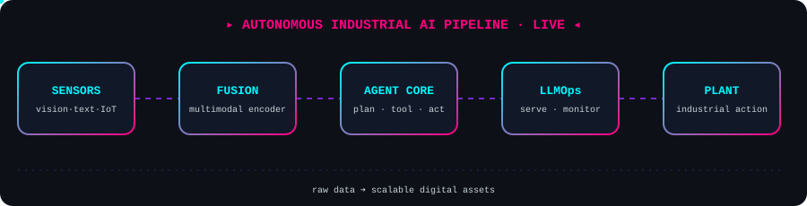
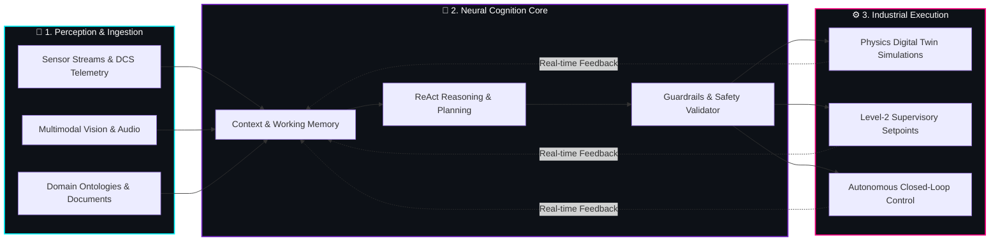

<!-- HERO BANNER -->

<!-- WAVING HEADER -->

<!-- LIVE TYPING TERMINAL -->

 

<!-- STATUS PILLS -->
&nbsp;&nbsp;&nbsp;

  

<!-- SOCIAL COMMAND BAR -->
&nbsp;&nbsp;&nbsp;&nbsp;

<!-- NEON DIVIDER -->

##  Executive Summary & Neural Profile

<table>
<tr>
<td width="52%" valign="top">

###  Greetings, Pioneers!

I am an **AI/ML Researcher & Senior Data Scientist** specializing in converting noisy, high-dimensional scientific and industrial data into autonomous **Digital Assets**.

 **Current R&D:** Architecting **Agentic AI Automation** frameworks for real-world industrial operations.

 **Scaling in Production:** Advancing **LLMOps** pipelines and **Multimodal Agentic AI** orchestration.

 **Core Philosophy:** Robust, reproducible, data-driven models built to survive complex industrial environments.

 **Collaborate with me on:** `Python` • `Agentic AI` • `LLMOps` • `Data Science` • `Industrial Automation`

</td>
<td width="48%" valign="top">

<pre><code class="language-yaml"># ==========================================
# 🧠 AUTONOMOUS AGENT MANIFEST: DR. ZAFARI
# ==========================================
agent_identity:
  lead_architect: "Dr. Ehsan Zafari"
  designation: "AI/ML Researcher | Data Scientist"
  mission: "Raw Data ➔ Scalable Digital Assets"

active_neural_modules:
  - module: "Industrial Agentic AI"
    status: "DEPLOYING_AUTONOMOUS_WORKFLOWS"
  - module: "Production LLMOps"
    status: "OPTIMIZING_INFERENCE_AT_SCALE"
  - module: "Multimodal Systems"
    status: "FUSING_VISION_TEXT_SENSOR_DATA"

core_metrics:
  precision: "Enterprise-Grade"
  domain_impact: "Scientific & Industrial AI"
  reproducibility: "By_Design"
  uptime_mindset: "Production_First"
</code></pre>

</td>
</tr>
</table>

<!-- NEON DIVIDER -->

##  Autonomous Industrial AI Architecture

  

<!-- NEON DIVIDER -->

##  How My Agents Think

<!-- NEON DIVIDER -->

##  Technical Arsenal & Engineering Ecosystem

| Domain | Core Technologies & Stack |
| :--- | :--- |
| **Languages & Runtimes** |     |
| **Agentic AI & LLMOps** |      |
| **Deep Learning & Modeling** |     |
| **Data Engineering & Big Data** |     |
| **Cloud, DevOps & Infra** |      |

<!-- NEON DIVIDER -->

##  Featured Industrial AI Projects

  
  

 

  
  

<!-- NEON DIVIDER -->

##  GitHub Trophies & Milestones

  

<!-- NEON DIVIDER -->

##  Real-Time Telemetry & Contribution Analytics

  
  &nbsp;&nbsp;
  

 

  

 

  

<!-- NEON DIVIDER -->

##  Contribution Activity Stream

  <picture>
    <source media="(prefers-color-scheme: dark)" srcset="https://raw.githubusercontent.com/Essi2030/Essi2030/output/github-contribution-grid-snake-dark.svg">
    <source media="(prefers-color-scheme: light)" srcset="https://raw.githubusercontent.com/Essi2030/Essi2030/output/github-contribution-grid-snake.svg">
    
  </picture>

  

  

